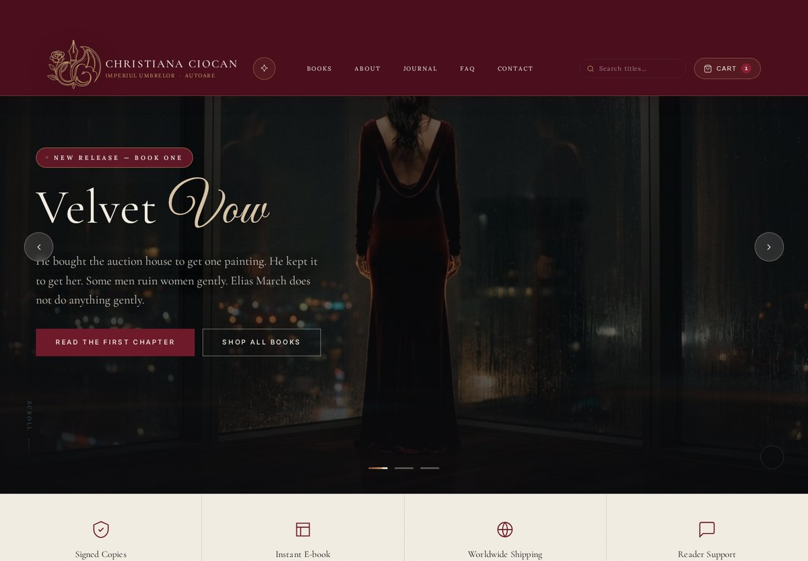
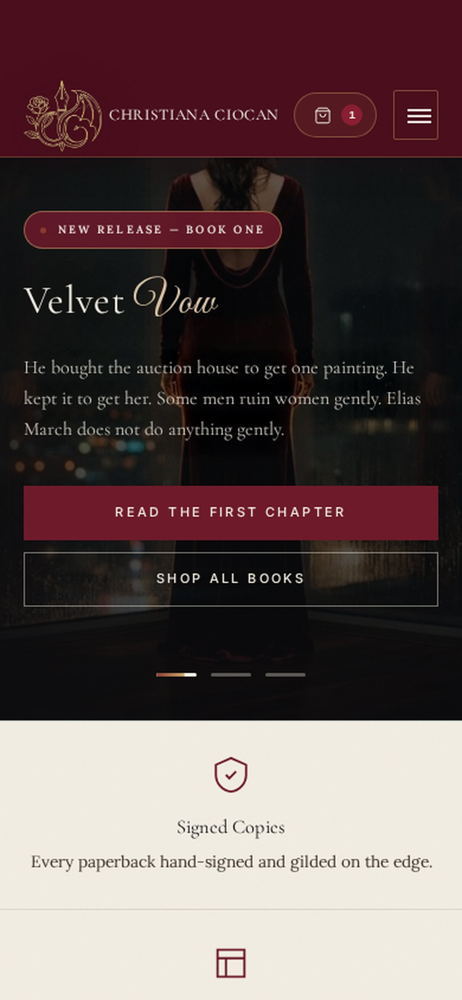
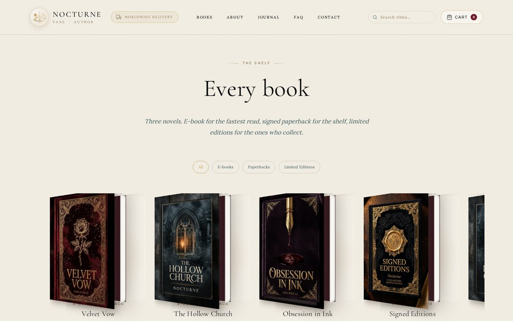
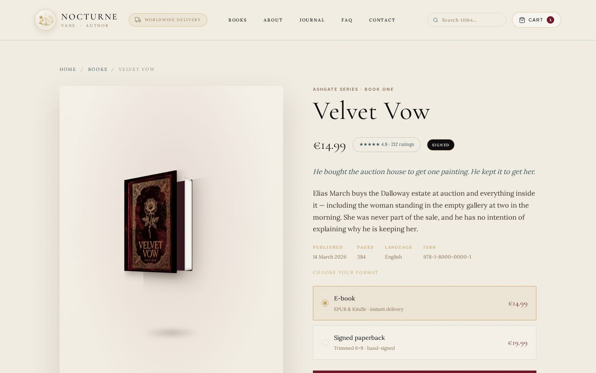
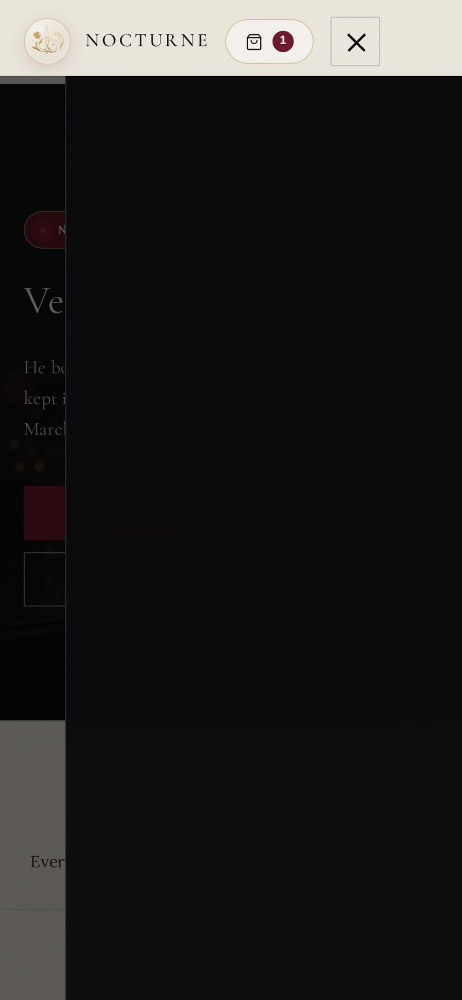
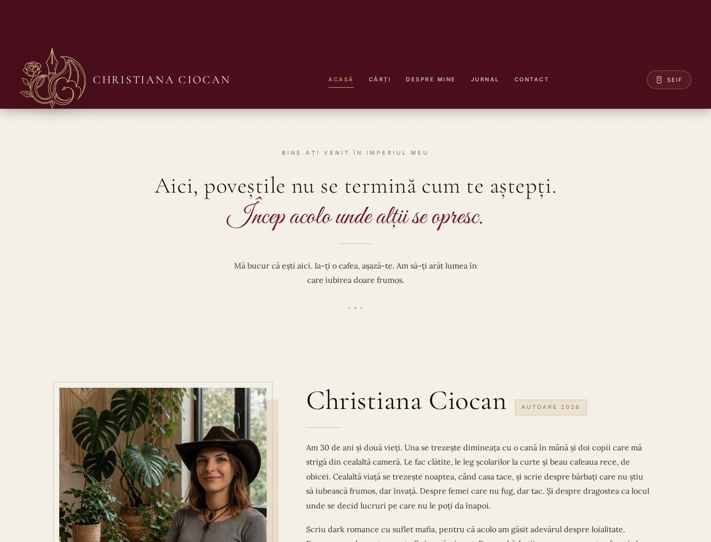
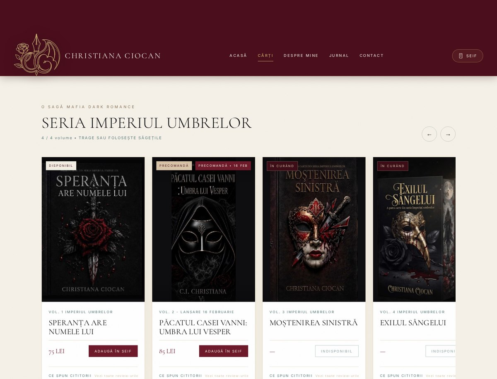
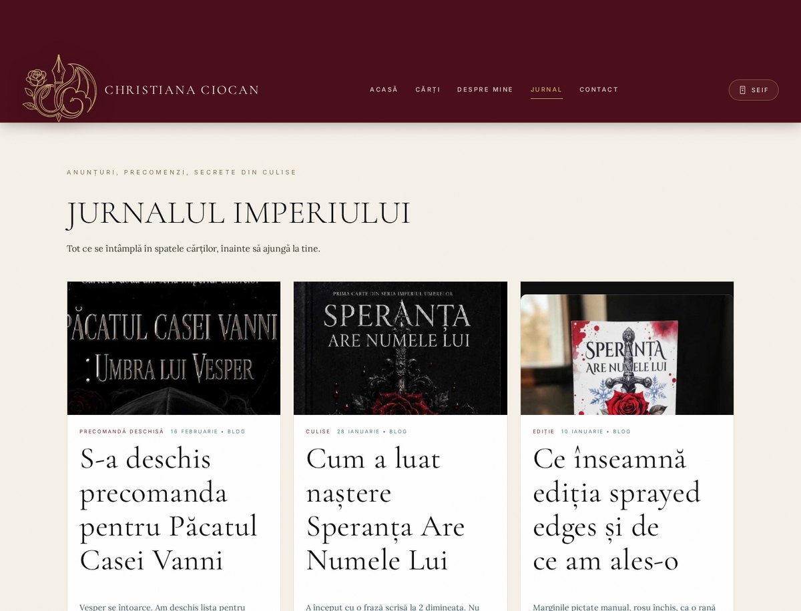

# Nocturne — Luxury Editorial WordPress Theme

A premium, mobile-first theme for **authors, publishers and creative studios** —
built as a WordPress child theme with WooCommerce, Elementor support and a
**full-bleed media slider** that works flawlessly down to a 375px phone.

> Built from a real Freelancer contest brief. Production-tested, accessibility
> checked, and documented so a non-developer can run the finished site.

[](https://www.php.net/)
[](https://wordpress.org/)
[](#license)
[](docs/guides/TESTING.md)

---

## 📸 Preview

<table>
<tr>
<td width="50%" valign="top"><br /><sub><b>Home</b> — the edge-to-edge hero slider, on desktop</sub></td>
<td width="50%" valign="top"><br /><sub><b>Home</b> — the 3D cover rail at 375px. Note the page block along each fore-edge</sub></td>
</tr>
<tr>
<td width="50%" valign="top"><br /><sub><b>Catalogue</b> — the showcase rail. Each cover is a real 3D object</sub></td>
<td width="50%" valign="top"><br /><sub><b>Book page</b> — one title, two format variations</sub></td>
</tr>
<tr>
<td width="50%" valign="top"><br /><sub><b>Navigation</b> — the drawer at 375px, with the close button still reachable</sub></td>
<td width="50%" valign="top"><br /><sub><b>Client edition</b> — the home page of the Christiana Ciocan design</sub></td>
</tr>
<tr>
<td width="50%" valign="top"><br /><sub><b>Client edition</b> — the Imperiul Umbrelor rail and the standalone titles</sub></td>
<td width="50%" valign="top"><br /><sub><b>Client edition</b> — the journal grid</sub></td>
</tr>
</table>

> The covers turn towards the reader on hover. Open the live preview and
> move your cursor across one to see it.

---

## ✨ Why this theme exists

Most author themes fall into one of two traps: either they look like a generic
WordPress template, or they look beautiful but the client cannot run them.

Nocturne does neither. It is:

- **Editorial by default** — a real type scale, a real colour system, and
  whitespace treated as a design material, not an afterthought.
- **Edge-to-edge on mobile** — the hero slider breaks out of its container to
  bleed to the physical screen edge, with **zero horizontal scrollbar** at any
  breakpoint. Verified by an automated test suite, not by eye.
- **Motion with a point of view** — a self-contained effects engine: reveals
  that cascade as you scroll, covers that turn like real objects, a header
  that condenses when you start reading. No library, no build step.
- **Maintainable by a non-developer** — every colour, every book, every
  coupon and every hero slide is editable from the WordPress admin.
- **Commerce-complete** — variable products with format variations, digital
  delivery, tax zones, multiple gateways, transactional email templates.

---

## 🎬 The hero slider — edge-to-edge, video-ready

This is the hardest thing to get right in a WordPress theme, and the most
common thing clients complain about.

```css
.vl-hero__stage {
  width: 100vw;
  margin-left: calc(50% - 50vw);   /* break out of any container */
  overflow: hidden;
}
```

The **media layer** has zero horizontal padding at every breakpoint. The
**content layer** keeps a comfortable gutter so text never touches the screen
edge. Getting that distinction right is the whole trick.

**Features**

| | |
|---|---|
| Video slides | `<video muted playsinline loop>` — iOS Safari autoplays correctly |
| Poster frames | Every video slide shows a still image while loading and on slow connections |
| Touch swipe | Vertical gestures are ignored so page scroll never fights the slider |
| Progress dots | Animated fill that matches the real slide duration |
| Pause control | Stops autoplay **and** pauses the videos (saves mobile data) |
| Off-screen pause | `IntersectionObserver` stops playback when scrolled away or the tab is hidden |
| Keyboard | Arrow keys, plus `aria-hidden` on inactive slides |
| `prefers-reduced-motion` | Fully honoured |

**Adding a slide from the admin** — no code, no FTP:

```
Appearance → Customize → Nocturne — Design System → Hero slides
```

One line per slide:

```
Image URL | Video URL | Kicker | Title | Excerpt | Button label | Button URL
```

Leave the video field empty for a still-image slide.

---

## ✨ The client edition — Christiana Ciocan

The theme also ships a second, complete design edition that reproduces the
client's approved artwork: the *Imperiul Umbrelor* series, the standalone
titles, the reviews, the journal and the vault (cart).

| Piece | Where |
|---|---|
| Design system | `template/assets/css/client.css` |
| Catalogue (books, reviews, posts, copy) | `template/assets/js/client-data.js` |
| Behaviour (rail, vault, overlay, reviews) | `template/assets/js/client.js` |
| Shortcodes | `template/inc/client-shortcodes.php` |
| Artwork | `template/assets/img/client/` |
| Static preview | `preview/client/` |

### Shortcodes

```
[nocturne_client_gates]        → the three gateways on the home page
[nocturne_client_series]       → the draggable book rail
[nocturne_client_standalone]   → the standalone titles
[nocturne_client_journal]      → the journal grid
```

`front-page.php` is already composed from these.

### Client artwork

`template/assets/img/client/` holds the eight source images from the client's
approved design. Three of them arrive as **open-book spreads**; the front
cover is cropped out and the original is kept alongside it as `spread-*.jpg`.

| File | What it is |
|---|---|
| `cover-speranta.jpg` | Speranța Are Numele Lui — front cover |
| `cover-paculul.jpg` | Păcatul Casei Vanni — front cover |
| `cover-mostenirea.jpg` | Moștenirea Sinistră — front cover |
| `cover-exilul.jpg` | Exilul Sângelui |
| `cover-a94.jpg` | Proiectul A-94 (phone mockup) |
| `speranta-stack.jpg` | the sprayed-edges stack |
| `author-portrait.jpg` | the author portrait |
| `logo-ci.jpg` | the gold monogram banner |
| `thumb-*.jpg` | wide crops used by the journal grid |
| `spread-*.jpg` | the untouched open-book spreads |

## 🎨 The design system

Every value is a CSS custom property, and every one is overridable from the
Customizer without touching a line of code.

```
PAPER & INK         ACCENTS           TYPE
  parchment #F2EDE3  burgundy #6E1A2B  Display  Cormorant Garamond 300/600
  paper-2   #F5F1E8  rose     #8B4A5C  Body     Lora 400/500
  sand      #D8C4A8  blood    #8B3A2F  Quote    Cormorant Garamond italic
  ink       #0E0E10  copper   #5A7A7A  UI       Inter 400/500/600
  ink-2     #1A0F12  gold     #C9A86A  Script   Great Vibes
  plum      #3D0E18  frost    #EBF5FB
TEXT
  ink       #0E0E10      LINE           rgba(90,122,122,0.18)
  muted     #3D5A5E
  dim      #E2DACD      HAIRLINE GOLD  rgba(201,162,39,0.28)
  muted    #A79FB2      TEXTURE        SVG fractal noise @ 2.8%
  muted-2  #7C7489      SHADOW         18px 44px -18px rgba(0,0,0,.85)
```

**Spacing scale** — 4 / 8 / 12 / 16 / 24 / 32 / 44 / 64 / 96 / 132 / 176
**Container** — 1280px (1520px for full-bleed headers)
**Radius** — 2px (4px on large surfaces) — sharp, editorial, not bubbly
**Motion** — `cubic-bezier(.22,.61,.36,1)`, 300–550ms

---

## ✨ The parchment layer

`assets/css/parchment.css` is a **design-token layer** that re-skins the theme
onto the client's approved palette: warm parchment paper, burgundy, rose,
copper and antique gold. It remaps the `--vl-*` custom properties and
restyles every major component — header, hero, split showcase, product rail,
catalogue, author block, pull quote, journal, newsletter, FAQ, forms, cart
drawer, product page and footer.

```
parchment.css   →  remaps the tokens  →  every component follows
```

Because it only changes tokens and a handful of component rules, **no
template markup or PHP is touched** — the WooCommerce cart, the search, the
mobile drawer, the 3D book and the whole effects engine keep working
exactly as before. Drop the file in and you get the parchment look; remove
it and you are back to the original dark skin.

It also ships a `prefers-color-scheme: dark` inversion, so visitors who
prefer a dark interface still get one — with gold and copper accents.

---

## ✨ The effects system

`assets/css/effects.css` and `assets/js/effects.js` are a **self-contained,
dependency-free motion layer**. Nothing to install, nothing to configure —
add an attribute and the effect runs.

### Reveal on scroll

```html
<h2 data-animate="fade-up">Velvet Vow</h2>
<p data-animate="fade-up" data-delay="120" data-duration="700">…</p>

<!-- a whole group cascades in sequence -->
<div data-group="90">
  <article data-animate="fade-up">…</article>
  <article data-animate="fade-up">…</article>
</div>
```

Fourteen effects are available: `fade`, `fade-up`, `fade-down`, `fade-left`,
`fade-right`, `zoom-in`, `zoom-out`, `slide-up`, `slide-down`, `blur-in`,
`flip-y`, `reveal-mask`, `text-entrance` and `letter-stagger`.

Each element gets `.is-in` when it enters the viewport. The observer is an
`IntersectionObserver`, so it costs nothing until something moves.

### The 3D book cover

The signature component. A real three-dimensional object: the cover turns
towards the reader on hover, and the striped page block appears along the
fore-edge exactly as a physical book would.

```html
<div class="vl-3d-book" data-tilt="6">
  <div class="vl-3d-book__shadow"></div>
  <div class="vl-3d-book__cover">
    <div class="vl-3d-book__pages"></div>
    <div class="vl-3d-book__face vl-3d-book__face--front"></div>
    <div class="vl-3d-book__face vl-3d-book__face--back"></div>
  </div>
</div>
```

| Token | Default | Meaning |
|---|---|---|
| `--book-w` | `200px` | Cover width |
| `--book-h` | `293px` | Cover height |
| `--book-depth` | `40.5px` | Thickness of the page block |

`data-tilt` adds pointer tracking so the cover leans towards the cursor.

### The product rail

A horizontal carousel with no library behind it.

```html
<div class="vl-rail">
  <div class="vl-rail__track">
    <article class="vl-rail__item">…</article>
  </div>
</div>
<button data-rail-prev>…</button>
<button data-rail-next>…</button>
```

The arrows step one whole card at a time and disable themselves at each end.
The track also responds to drag and to the keyboard.

### Everything else

| Component | Class | What it does |
|---|---|---|
| Split hero | `.vl-split-hero` | 3D cover beside a looping video; the cover swaps with the slide |
| Sticky header | `.vl-header.is-stuck` | Condenses from 96px to 70px after 10px of scroll; the logo swaps to a smaller lockup |
| Ticker | `.vl-ticker` | A slow marquee of accolades |
| Magnetic buttons | `data-magnetic="0.28"` | Buttons drift towards the cursor |
| Parallax | `data-parallax="0.2"` | Elements move slower than the scroll |
| Prose | `.vl-prose` | Long-form text: page content, blog posts, reading samples |

### Shortcodes

| Shortcode | What it does |
|---|---|
| `[nocturne_showcase count="6"]` | The 3D product rail, built from your real WooCommerce products |
| `[nocturne_split_hero]` | The cover-and-video hero. One slide per line: `Image \| Video \| Title \| Excerpt \| Cover` |
| `[nocturne_ticker items="A \| B \| C"]` | The marquee |
| `[nocturne_hero slides="…"]` | The full-bleed slider |

Everything respects `prefers-reduced-motion`. With that setting on, the
reveals appear immediately, the ticker stops and the tilt is disabled.

---

## 🛒 Commerce

| Feature | How it works |
|---|---|
| Book pages | One WooCommerce **variable product** per title — the product page *is* the book page |
| Formats | Product variations: E-book (virtual + downloadable) and Paperback (physical, weight + dimensions) |
| Digital delivery | Download permission: `order`, 30-day limit, customer can re-download |
| Tax | Per-product tax class — printed books and e-books often qualify for different EU VAT rates |
| Shipping | Zone-based flat rate, with a digital-only zone that skips shipping automatically |
| Gateways | Stripe, PayPal and offline/manual enabled side by side |
| Emails | All templates editable in **WooCommerce → Settings → Emails** |

---

## 🚀 Install

### Option A — WordPress admin

1. **Appearance → Themes → Add New → Upload Theme**
2. Choose `nocturne.zip`
3. **Install Now → Activate**
4. Install **WooCommerce**
5. **Appearance → Nocturne Setup → Import demo content**

The importer creates 3 books with both format variations, a full blog post,
the About/Contact/FAQ/Journal pages, a primary menu and a sample coupon.
It is idempotent — running it twice creates no duplicates.

### Option B — WP-CLI

```bash
wp theme install nocturne.zip --activate
wp plugin install woocommerce --activate
wp eval 'nocturne_import_demo_content();'
```

### Parent theme

Declares `Template: kadence`. Also compatible with **GeneratePress**, **Astra**
and **OceanWP** — change the `Template:` line in `style.css` to switch.

---

## 📁 Structure

```
nocturne/
├── template/
│   ├── style.css                 theme header + parent declaration
│   ├── functions.php             design system, slider, customizer, admin helpers
│   ├── header.php                site header (sticky-shrink, search, trust badge)
│   ├── footer.php                site footer
│   ├── front-page.php            the landing layout: split hero, 3D rail, ticker
│   ├── inc/demo-content.php      one-click demo importer
│   ├── inc/shortcodes.php        showcase, split hero and ticker shortcodes
│   ├── inc/client-shortcodes.php the client edition: gates, series, standalone, journal
│   └── assets/
│       ├── css/nocturne.css      the entire design system
│       ├── css/modules.css       WooCommerce + Elementor modules
│       ├── css/effects.css       the motion layer: reveals, 3D covers, rail, hero
│       ├── css/parchment.css     the parchment token layer
│       ├── css/client.css        the client edition design system
│       ├── js/nocturne.js        slider, forms, cart drawer
│       ├── js/effects.js         the effects engine (no dependencies)
│       ├── js/client-data.js     the client catalogue
│       ├── js/client.js          the client rail, vault, overlay and reviews
│       ├── img/                  logo.svg, favicon.svg, cover-signed.jpg
│       └── img/client/           the client's eight source images
├── preview/                     a live static preview of the theme
├── docs/
│   ├── guides/                   client-facing documentation
│   └── screenshots/
├── 🔧 scripts/
│   ├── build-theme.sh              builds dist/nocturne.zip
│   ├── setup-tests.sh              installs/removes the test browser
│   ├── test_theme.py               full browser QA suite
│   └── test_bleed.py               the edge-to-edge hero check
└── .github/workflows/            CI
```

---

## 🧪 Testing

```bash
# The theme has zero dependencies — this is only for the QA scripts.
bash scripts/setup-tests.sh         # ~730 MB of browser, install once

cd preview && python3 -m http.server 8080 &
NOCTURNE_BASE=http://localhost:8080 python3 scripts/test_theme.py

bash scripts/setup-tests.sh --remove   # free the space again
```

The suite is browser-driven and covers:

- ✅ Horizontal overflow at 375 / 390 / 768 / 1440 / 1920 px
- ✅ Hero slider edge-to-edge bleed (stage width, padding, position)
- ✅ Slider advance, dot navigation, pause toggle, swipe
- ✅ Mobile nav drawer and cart drawer
- ✅ Form validation blocks empty submits
- ✅ Missing `alt` attributes, accessible names, heading hierarchy
- ✅ Broken images, console errors, leftover placeholder text
- ✅ Elements clipping outside the viewport

The browser is **optional tooling** — the theme itself ships with no
JavaScript framework, no build step and no runtime dependencies.

See [`docs/guides/TESTING.md`](docs/guides/TESTING.md).

---

## ♿ Accessibility

- Semantic landmarks and heading hierarchy (exactly one `h1` per page)
- Visible `:focus-visible` rings with a gold accent
- AA contrast on the dark palette
- `alt` text on every meaningful image; decorative art is marked
- `prefers-reduced-motion` disables transforms and autoplay
- Slider slides use `aria-hidden`; controls are labelled
- Form errors are announced and written in plain language

---

## 🔐 Security & privacy

- **Spam protection** — honeypot field plus a server-side
  minimum-time-to-submit check, wired into Contact Form 7
- **GDPR cookie banner** — included, with accept/decline and `localStorage`
- **No external dependencies** — no CDN, no jQuery, no icon-font library
- **Escaped output** — every dynamic value passes through `esc_html`,
  `esc_attr` or `esc_url`
- **Structured data** — `Person`, `Book`, `Product` + `AggregateOffer`,
  `BlogPosting`

---

## 📚 Documentation

| Guide | For |
|---|---|
| [`HANDOFF-GUIDE.md`](docs/guides/HANDOFF-GUIDE.md) | The client — running the site day to day |
| [`DEPLOYMENT.md`](docs/guides/DEPLOYMENT.md) | The client — hosting, SSL, going live |
| [`WOOCOMMERCE-SETUP.md`](docs/guides/WOOCOMMERCE-SETUP.md) | The client — every shop screen |
| [`CUSTOMISING.md`](docs/guides/CUSTOMISING.md) | Developers — extending the design system |
| [`TESTING.md`](docs/guides/TESTING.md) | Developers — the QA suite |
| [`ROADMAP.md`](docs/guides/ROADMAP.md) | Everyone — what comes next |
| [`ARCHITECTURE.md`](docs/ARCHITECTURE.md) | Developers — how the layers fit together |

---

## 🛠 Roadmap

| Version | Focus |
|---|---|
| **v1.0** | ✅ Complete — design system, hero slider, WooCommerce, demo importer, QA suite |
| **v1.1** | Gutenberg blocks + block patterns |
| **v1.2** | `theme.json` alignment, designed dark/light modes |
| **v1.3** | Token pipeline — one file drives CSS, Elementor and Figma |
| **v1.4** | Performance budget enforced in CI |
| **v1.5** | Commerce depth — subscriptions, bundles, product add-ons |
| **v1.6** | The reading experience — typography controls, progress tracking |
| **v1.7** | Extensibility — filters, options API, hook reference |
| **v1.8** | Internationalisation and RTL |
| **v2.0** | Standalone Full Site Editing theme |

Full detail in [`docs/guides/ROADMAP.md`](docs/guides/ROADMAP.md).

**Workflow:** work on `develop`, merge to `main` only via a reviewed PR.

---

## 📄 License

**GPL-2.0-or-later** — the same license as WordPress.

You may use, modify and redistribute this theme, including commercially.
Derivative themes must also be GPL-2.0-or-later.

See [`LICENSE`](LICENSE).

---

<div align="center">

**Nocturne** — a dark theme for people who care about the reading,
not just the selling.

</div>
